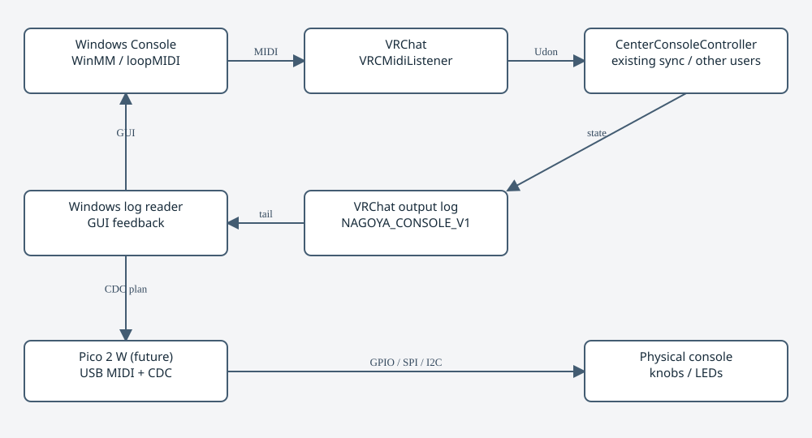
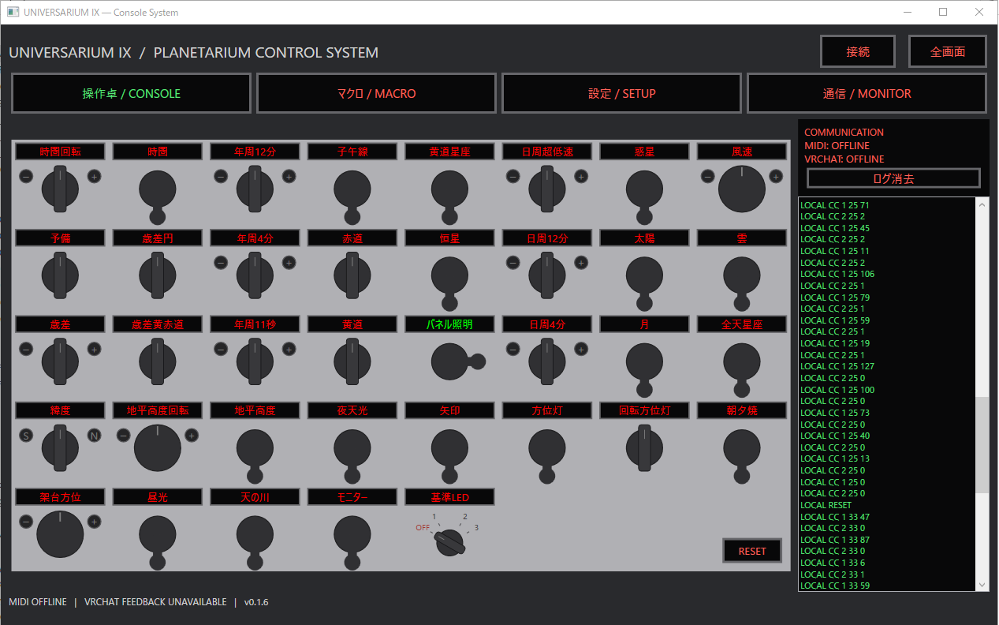
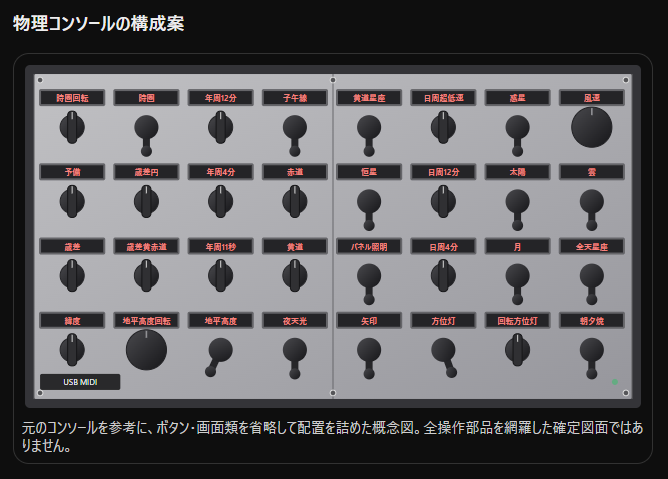
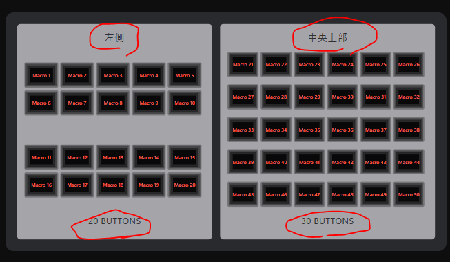
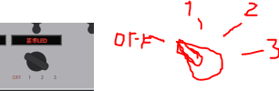
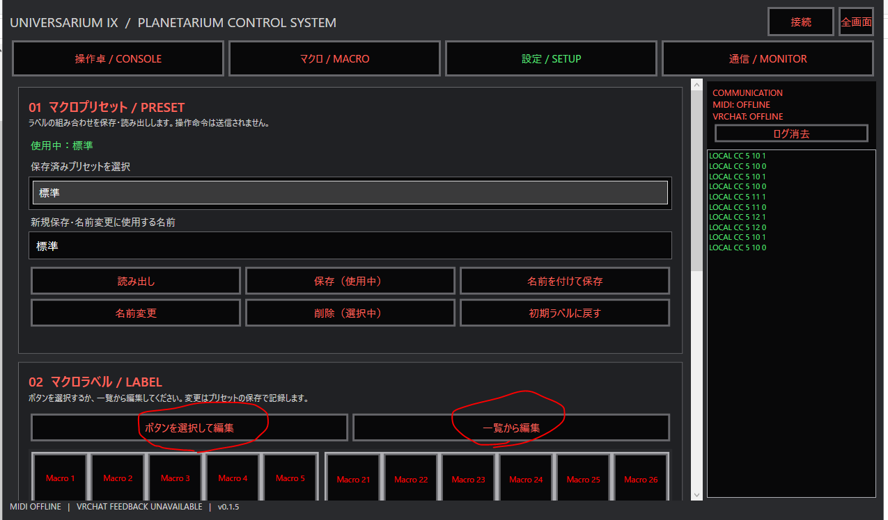
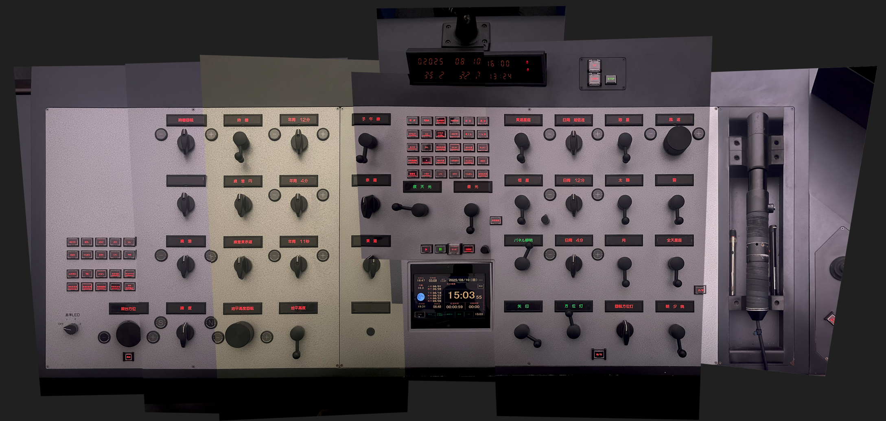

# NagoyaConsole 総合仕様・製作引継ぎ
2026-11-26 / 統合パッケージ v0.1.7 / Windows v0.1.6 / UdonSharp v0.1.7

本資料は将来の物理コンソール製作再開用。Pico 2 Wのみ発注済みとの申告に基づく。他の部品は購入確定ではない。実装と設計案を区別する。

## 資料一覧
- [ハードウェア仕様・BOM](01_ハードウェア.md)
- [配線・接続図](02_配線.md)
- [Windows操作・保存仕様](03_Windows.md)
- [MIDI・フィードバック通信](04_通信.md)
- [Unity導入・検証](05_Unity.md)
- [全操作ID表](06_ID一覧.md)
- [製作・試験チェックリスト](07_検証.md)
- [MIDIコマンド仕様書](08_MIDIコマンド仕様書.md)
- [従来のREADME](README.md)

## 全体構想
Windowsタッチ操作卓を先行開発し、Pico 2 W版の物理入力を後から追加する。既存のCenterConsoleControllerのvalues、angles、macroと7個のulong同期を維持する。物理版は37つまみ＋中央6列×5段の30マクロを計画。ソフト版は全61マクロ。画面や日時表示器は物理版では省略。

## 現行画面（ユーザー提供 v0.1.6）

## デザイン資料

## 重要な未解決事項
- 物理部品の定格・接点・LEDラベル挿入式完成品は未確定。部品価格は過去の検討時の参考値で、現在の在庫を保証しない。
- Windowsソースはユーザー提供画面でv0.1.6の起動を確認できるが、全機能の試験結果はない。今回EXEは同梱しない。
- Unityの操作ロックとの統合、実シーンの全マクロ割り当て、SDK互換性、Udonコンパイル、実通信は未検証。
- ログは公式双方向APIではない。Pico用USB CDC、LED状態パケット、ファームウェアは設計案のみ。
- 既存Windowsソースを維持し、最新UdonSharp差し替えファイル2本を統合。Git変更なし。

最新の画面配置・Scene JSON出力は `10_v0.1.9変更点.md` を優先。

- 最新UI差分: [11_v0.1.10変更点.md](11_v0.1.10変更点.md)（過去の配置記述より優先）。

- 最新の表面仕上げ: [12_v0.1.11変更点.md](12_v0.1.11変更点.md)（旧仕上げ記述より優先）。

## v0.1.12 追記（最新）
Windows操作卓にStatusMonitor準拠の7セグメントINFOを追加。既存MIDIとは別の出力ログでVRChat→Windowsのみ。導入・検証は[変更点](13_v0.1.12変更点.md)と開発者向け導入_v0.1.14.mdを参照。

## v0.1.13 追記（最新）
INFOと昇降操作を操作卓上部へ集約。マクロ画面は固定寸法・均等縮小、3枚のプレート。詳細は[変更点](14_v0.1.13変更点.md)。
