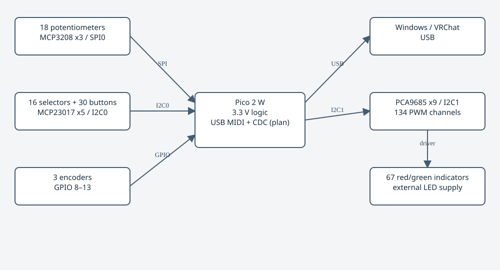

# 配線仕様・接続図（回路設計前の案）

## Picoピン割当案（GPIO番号）
|信号|GPIO|接続|
|---|---|---|
|SPI0 MISO|GP16|3 ADC DOUT共通|
|SPI0 SCK|GP18|CLK共通|
|SPI0 MOSI|GP19|DIN共通|
|CS1/2/3|GP20/21/22|各ADC CS、未選択HIGH|
|I²C0 SDA/SCL|GP4/5|MCP23017|
|I²C1 SDA/SCL|GP6/7|PCA9685|
|Encoder A/B ×3|GP8/9,10/11,12/13|接点入力、プルアップ|
|USB|Micro-B|PC、MIDI/将来CDC|

MCP3208 DIP16: CH0～7=1～8、DGND=9、CS=10、DIN=11、DOUT=12、CLK=13、AGND=14、VREF=15、VDD=16。VDD/VREFは3.3V、GND共通。データシート照合のうえ実装。可変抵抗の両端を3.3V/GND、ワイパーから100Ωを通してCH入力、CHから100nFをGNDへ（試作値、セトリング確認）。入力に5Vを入れない。未使用入力は適切に終端。

ADC割当はID一覧のアナログ番号順にADC1 CH0～7、ADC2 CH0～7、ADC3 CH0～1。SPI 1MHz案、18ch×24クロック=432µs理論値、実測ではない。全体500～1000Hzサンプリング、平均化とヒステリシス、変更時送信最大30～60Hz/軸を目標（未実装）。

MCP23017: 3.3V、アドレス0x20～0x24、A0～A2を固定、RESETを適切にプルアップ。スイッチのCOMをGND、各接点を入力＋プルアップ。入力番号0～42をセレクター、43～72をマクロに割り当てる案。I²Cは各モジュールの既設プルアップを確認して合成抵抗を調整。400kHzは候補。エンコーダーはA/B相をGPIOで取得し、デバウンス・方向を確認。

PCA9685: I²C1、0x40～0x48を仮割当（ALLCALL等の応答アドレスと重複しないことを確認）。ロジック3.3V、LED電源は独立、GND共通。2色LEDの極性・共通アノード/カソードに合わせて駆動回路を設計する。PCA9685の出力を高電圧表示灯へ直接接続しない。電流制限と出力電流・総電流・発熱を確認。USBの5Vと外部5Vを無条件に直結しない。LEDのPWM電流をADC基準・アナログGNDから分離する。

LED出力案: 表示灯0～36、マクロ37～66、各表示灯の赤=2n、緑=2n+1。出力16chごとにドライバーを分割。±灯追加時は別番号を確保する。最終回路図、PCB、電源保護、定格は未確定。
