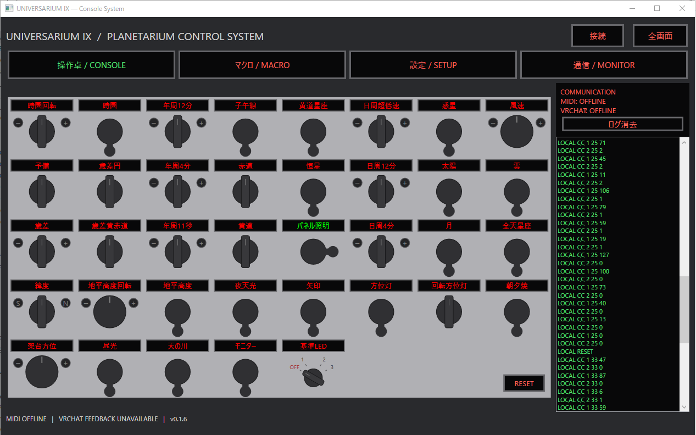

# Windowsソフト仕様 v0.1.6
C# / WPF / .NET 10 / win-x64。WinMM P/InvokeでMIDI出力（NAudio不使用）。Build_Windows.batで自己完結型単一EXEをReleaseへ生成。loopMIDIは別途必要。オフラインGUIは使用可能。

- 操作卓: 8列×5行のうち37操作、右下RESET（86×36 DIP）、右側通信モニター常時表示。
- マクロ: 左5列×2段を2区画、中央6列×5段、下に11独立枠。区画説明文字なし。初期名はMacro 1～51と10個のシステム名（仮）。黒背景で文字だけ赤/橙/緑。
- 設定: プリセット選択、読み出し、保存、名前を付けて保存、名前変更、削除、初期ラベル。ボタン選択編集・一覧編集は同じボタンの再押下で閉じ、他方式へ切替可能。編集後は保存操作が必要。読み出し時はMIDI送信しない。
- 通信: 詳細ログと右側短縮ログ。消去は両方のアプリ表示のみでVRChatファイルは削除しない。接続状態とフィードバック状態を独立表示。赤=未接続/未受信、緑=接続/受信。接続・切断切替ボタン96 DIP、全画面100 DIP、間隔16 DIP。
- 画面: 操作卓・マクロはViewboxで比例拡大。設定と通信は領域内スクロール。F11/全画面ボタン、Escで解除。ウィンドウサイズはタブで変えない。画面位置の保存やマルチモニター・DPI実機確認は未完了。
- 入力: マウス、タッチ、ペンのcapture、上下/円弧ドラッグを初動で選択、ホイール微調整。マクロ押下/解放を個別送信。入力喪失時の解放処理あり。複数指・実機の検証は未実施。
- パネル照明(ID33): 灰色RGB(127.5,127.5,127.5)から赤/緑/橙へ線形補間。項目・マクロ・方向灯対象、ナビゲーション除外。
- ダイヤル: 中立0.5、±180°、OFF範囲0.49<v<0.51。v0.1.4以降は範囲内MIDI=512へ統一し重複送信抑制。Unityは元の値を保持するため厳密な挙動差がある。
- 基準LED: 表示角度-60/-30/+30/+60°、OFF/1/2/3、内部値-1/0/1/2。Unityの表示角度は変更しない。
- RESET: 確認ダイアログ後、接続中は既存Resetを要求。オフラインはダイヤル0.5、基準LED-1、他0、マクロ0へ戻す（Unityの初期値と一致未確認）。プリセットは維持。

## 保存
EXE横のData/macro.json: 選択中プリセットと61ラベル配列の辞書。Data/settings.json: MIDIデバイス名、自動接続、幅・高さ。JSONはGUIに露出させない。つまみ位置は永続保存しない。起動時の状態は仮初期値からログ受信で更新。ソフト更新時は旧Dataをバックアップし新EXE横にコピーする。設定ファイルの書込権限が必要。

## v0.1.13 追記（最新）
INFOと昇降操作を操作卓上部へ集約。マクロ画面は固定寸法・均等縮小、3枚のプレート。詳細は[変更点](14_v0.1.13変更点.md)。

## v0.1.17 非線形フェーダー

外部MIDIの絶対値割当ごとに線形・カスタム%・音響dBを選択。入力に正変換、モーターフェーダーへの出力に逆変換を適用。詳細は18_v0.1.17変更点.mdとルートREADME.mdを参照。
