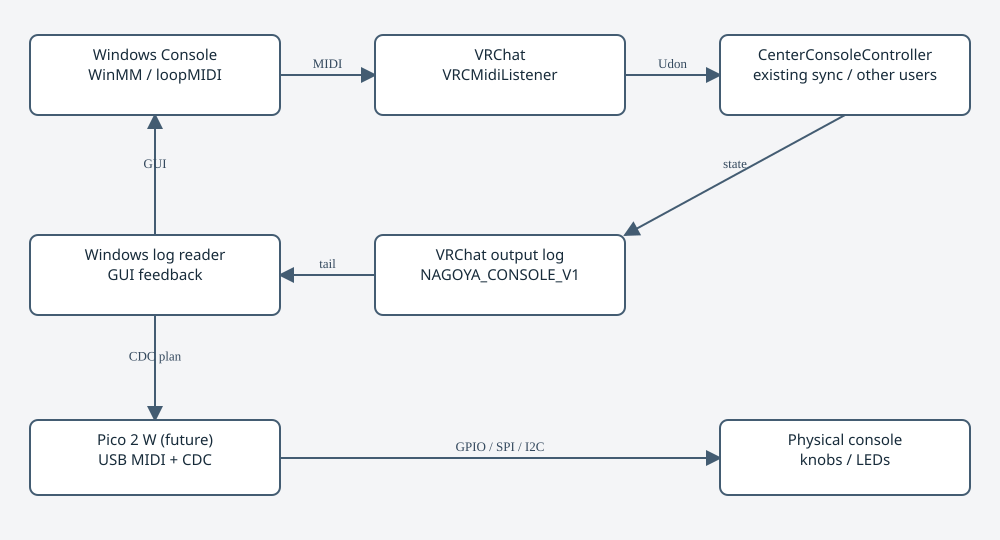

# 通信仕様 v1（現行ソースと将来案）

## MIDI CC (0始まりのch / 実機表示ch+1)
|ch|表示ch|Number|Value|
|---:|---:|---|---|
|0|1|NagoyaSw ID|下位7bit|
|1|2|NagoyaSw ID|上位3bit・確定|
|2|3|NagoyaSw ID|2位置0/1、3位置0/1/2→-1/0/+1、4位置0/1/2/3→-1/0/1/2|
|3|4|ダイヤルID|相対値: 64中立、差分=(value-64)/1023|
|4|5|NagoyaMacro ID|1押下、0解放|
|5|6|0|1でRESET|

10bit値q=round(clamp(v,0,1)*1023)、下位=q&127、上位=q>>7、復元=((hi<<7)|lo)/1023。下位受信後250ms以内に上位を受信して確定。USB MIDI 1.0 CC status=0xB0|ch。例: 恒星ID25、q512は B0 19 00 / B1 19 04。Windowsは絶対値、物理エンコーダーは相対ch3案。ダイヤルOFFはq512、逆側最大501、正側最小522（現行Windows実装）。連続値のMIDI送信頻度制限は未実装。複数ソースのパケット混在を避ける。

## ログフィードバック（実装済み・実機未検証）
`[NAGOYA_CONSOLE_V1] ` に続き40個のvalues×10000の整数CSV、区切り `|`、61個のmacro整数CSV（0/1/2）。anglesそのものは送らず、GUI側でvaluesから描画。Udonは100ms間隔で状態確認、変更時出力、変化なしでも2秒ごとheartbeat。Windowsは100ms周期で最新のoutput_log_*.txtを追尾し、4秒受信なしでOFFLINE。ログ切替時は末尾から開始。受信でGUI更新しMIDIを再送しない。複数クライアント・ログ遅延・負荷・偽のログ行・操作競合への対策は未完了。

## Picoフィードバック（未実装案）
USB複合デバイスMIDI + CDC。Windows側がログを読み、CDCで表示灯状態を送る。67灯×2bit=134bit、全体輝度8bit、合計142bit=18byte（2bit余り）。ヘッダー・連番・CRC等6byteを加え24byte案。ビット順・フレーム同期・CRC方式・タイムアウトは未確定。例として0=消灯、1=赤、2=緑、3=橙を候補とする（macroの0/1/2とは別定義）。±灯は追加容量が必要。Wi-Fi/UDPは将来候補。物理版とWindows版の同時使用時のMIDI集約も未実装。

## v0.1.12 INFO フィードバック（別レコード）
`[NAGOYA_INFO_V1] ` + `Output[0..6] CSV|方向9bit mask|7項目の桁数CSV|点灯RGB24整数,消灯RGB24整数`

例: `[NAGOYA_INFO_V1] 02026,11,26,21:30,35.2,-32.5,02:54|9|5,2,2,5,5,5,5|16711680,1703936`

方向 bit0=中央、bit1～8=0～315度（45度間隔）。90度停止は9、移動中は1。角度の再計算をWindowsで行わない。桁数は Unity の各 GameObject 配列長（未割当時は既定値）。色は 0xRRGGBB の10進表記。VRChat側で既存の100ms処理内に追加、変化時または2秒heartbeat。Windowsでは既存ログを1回だけ読み、INFO識別子を別に処理。4秒タイムアウトで全消灯。ログ切替でもリセット。MIDIコマンド・UdonSynced・RequestSerialization 追加なし。

## v0.1.14 ラベル取得（要求時のみ）
表示Ch7（内部6）、Number=要求ID、Value=1。既存の入力許可・Owner・初回同期・Feedback Enabledを満たす場合のみ応答。0.25秒のローカル受付間隔。`[NAGOYA_LABEL_V1] requestId|id|hex` を61 ID分、最後に `requestId|END|61`。hexはUTF-16コード単位を4桁大文字16進数で連結し、空欄は空文字。256コード単位超過は `requestId|ERR|id` で中断。Windowsは5秒以内に同じ要求IDの全61件とENDを受信した場合のみ取り込み可能。設定タブへ移動時に1回要求、明示再取得も可能。既存プリセットは自動変更しない。

## v0.1.16 市販MIDI機器の中継

物理MIDI CC/NoteをWindows内で変換して既存のVRChat向けコマンドへ送信する。VRChatからは従来のログを受信し、任意で物理MIDI出力に反映する。ワールド側通信規格に追加・変更なし。詳細は `17_v0.1.16変更点.md`。
