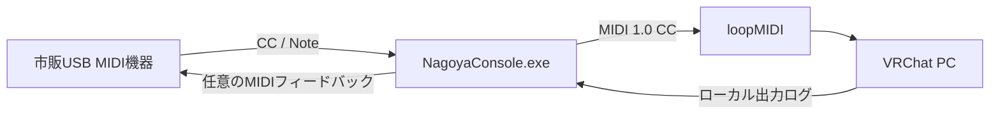

# NagoyaConsole

NagoyaConsole は、対応する VRChat プラネタリウムワールドの投影機を Windows PC から操作するための外部操作卓です。マウス・タッチ・ペンで操作でき、ワールド内の操作状態と INFO 表示を確認できます。

**バージョン: v0.1.17（2026-11-26）**

## 動作環境・必要なツール

| 項目 | 用途 | 入手先 |
| --- | --- | --- |
| Windows x64 | NagoyaConsole.exe の実行 | — |
| VRChat PC 版 | 対応ワールドへの接続 | [VRChat](https://hello.vrchat.com/) |
| loopMIDI | Windows 上の仮想 MIDI ポート | [loopMIDI 公式サイト](https://www.tobias-erichsen.de/software/loopmidi.html) |
| .NET 10 / WPF | NagoyaConsole の動作基盤 | [Microsoft .NET 10](https://dotnet.microsoft.com/download/dotnet/10.0) |

NagoyaConsole は `net10.0-windows`、win-x64、Self-contained 形式でビルドします。生成済みの EXE を利用する場合は通常、.NET の別途インストールは不要です。Unity や開発環境をインストールする必要はありません。

## 接続方法

### 1. loopMIDI の設定

loopMIDI をインストールして起動し、仮想 MIDI ポートを作成します。

推奨ポート名:

```text
Nagoya Console MIDI
```

VRChat と NagoyaConsole の使用中は loopMIDI を起動した状態にしてください。

### 2. VRChat の設定

Steam のライブラリで VRChat のプロパティを開き、起動オプションに次の内容を設定します。

```text
--midi="Nagoya Console MIDI"
```

ポート名は loopMIDI で作成したものと完全に一致させてください。設定後、VRChat を再起動し、NagoyaConsole 対応ワールドに入室します。

### 3. NagoyaConsole の設定

1. `NagoyaConsole.exe` を起動します。
2. 「設定 / SETUP」を開き、「MIDI出力デバイス」で作成したポートを選択します。表示されない場合は「デバイス一覧を更新」を押します。
3. 画面上部の「接続」を押します。既に「切断」と表示されている場合は MIDI ポートが開いています。
4. 通信モニターで `MIDI: CONNECTED` と `VRCHAT: ACTIVE` を確認します。
5. 操作卓の INFO が受信できていることを確認します。

MIDI CONNECTED は MIDI ポートの接続、VRCHAT ACTIVE は対応ログの受信を意味します。実際の操作にはワールド側の操作権限が必要です。

## 使い方

| タブ | 内容 |
| --- | --- |
| 操作卓 / CONSOLE | 投影機のつまみ・スイッチ、昇降操作、INFO 表示、RESET |
| マクロ / MACRO | マクロボタン、再生、一時停止、サーチ |
| 設定 / SETUP | MIDI デバイス、マクロラベル、プリセット、自動接続、市販MIDI機器の割り当て |
| 通信 / MONITOR | 送受信・接続ログの確認と消去 |

選択中のタブや設定の編集モードはオレンジ色になります。通常のボタンも押下中にオレンジ色で表示し、解放後は本来の表示に戻ります。マクロの状態表示はワールド側のフィードバックとパネル調光に従います。通信の接続状態は従来どおり緑・赤で区別します。

- 全画面切替: 画面上部の「全画面」または F11。Esc で解除できます。
- INFO: 年月日、時刻、緯度、太陽高度、地方恒星時、丸型方向灯を表示します。
- RESET: 確認ダイアログを経て実行します。
- 右側の通信モニターは各タブで確認できます。

### マクロラベルとプリセット

「設定」を開くと、MIDI 接続中は VRChat に全61件のラベルを1回だけ要求します。取得できない場合は「VRChatから再取得」を押してください。

「取得したラベルを別プリセットとして取り込む」で受信したラベルを利用できます。現在のプリセットは自動で上書きしません。「ボタンを選択して編集」または「一覧から編集」で名前を変更し、保存します。JSON ファイルからのプリセット取り込みにも対応します。

### 市販MIDIコントローラーの使用（任意）

従来のloopMIDI接続は維持し、物理MIDI入力をNagoyaConsoleに接続します。外部のMIDI変換ソフトは不要です。

1. 市販MIDI機器をUSB等でPCに接続し、必要ならメーカーのドライバーをインストールします。
2. 「設定 / SETUP」→「04 外部MIDI / MIDI LEARN」を開きます。
3. 物理MIDI入力を選びます。LEDやモーターフェーダーに状態を戻す場合のみ、対応する物理MIDI出力も選択します。
4. 「物理MIDI接続 / 設定保存」を押します。必要に応じて起動時の自動接続を選択します。
5. 割当対象を選び、入力方式を選択します。「MIDI Learn」を押し、対応する実機のつまみ・ボタンを1回操作します。チャンネル・CC番号またはNote番号が入ります。手動入力も可能です。
6. 必要に応じて反転・ソフトテイクオーバー・フィードバック方式を設定し、「割当を保存 / 更新」を押します。対象ごとに繰り返します。
7. 操作卓またはマクロタブへ戻ります。通常のMIDI接続とVRChatフィードバックが有効になってから実機を操作します。

設定タブでは誤操作防止のため物理入力からワールドへの送信と物理出力を一時停止します。Learnでは最初の対象CC/Noteを取得するだけで、操作コマンドは送信しません。登録済み割当を選ぶと編集できます。

| 入力方式 | 対象・仕様 |
| --- | --- |
| CC 7bit | つまみ・セレクター。0～127を既存の10bitまたは段階値へ変換（実質128段階） |
| CC 14bit | つまみ・セレクター。CC 0～31のMSBと番号+32のLSBを組み合わせる。対応機器のみ |
| 相対 CC 2の補数 | 0/64=停止、1～63=正、65～127=負（value−128） |
| 相対 CC 64中心 | 64=停止、value−64が増減量 |
| CC ボタン | マクロ。64以上で押下、64未満で解放（反転可） |
| Note ボタン | マクロ。Note On velocity>0で押下、Note OffまたはNote On velocity=0で解放 |

絶対値入力のソフトテイクオーバーは初期設定で有効です。物理つまみが画面の現在値に近づくか、その値を通過するまで操作を待機します。実機のボタンはモーメンタリー（押すとON、離すとOFF）に設定してください。RESETは誤操作防止のため割当対象外です。

#### 非線形フェーダーカーブ（v0.1.17）

「04 外部MIDI / MIDI LEARN」の割当ごとに、フェーダーカーブを選べます。従来の割当はリニアのままです。

| カーブ | 内容 |
| --- | --- |
| リニア | MIDI値を0～100%へ比例変換 |
| カスタム % | MIDI値の正規化位置%と操作値%を任意の校正点で指定し、区間線形補間 |
| 音響 dB | MIDI値の正規化位置%とdBを校正点で指定。最大dBを100%として振幅比に変換 |

例（特定機種の実測値ではありません）:

```text
0=-inf
5=-60
15=-40
30=-20
45=-10
60=-5
75=0
90=5
100=10
```

左側は受信MIDI値の0～100%（反転を適用した後）、右側はdBです。MIDI値が物理ストロークに比例するとは限らないため、実機の各目盛に対応するMIDI値を測定して左側へ入力してください。7bitなら `CC値 / 127 × 100`、14bitなら `値 / 16383 × 100` です。

- 音響dB方式は `10^((dB - 最大dB)/20)` を使用します。最大+10 dBの場合、0 dBは約31.62%。最下端は0%、最初の有限dB点までは振幅で補間します。
- 0 dBを別の操作値にしたい場合はカスタム%方式で任意に指定できます。
- 始点0%、終点100%、位置と値は厳密な昇順、最大64点。dB方式は先頭のみ `-inf`（`-∞`、`∞`も可）、有限値は-120～+24 dB。カスタム%方式は出力始点0・終点100です。
- CC7/CC14の連続操作のみ。相対エンコーダー、段階スイッチ、マクロには非線形設定を適用しません。
- モーターフェーダーへの出力は同じカーブの逆変換、ソフトテイクオーバーはMIDI位置空間で比較します。プレビューは送信しません。
- 保存先は `Data/external-midi.json` の各割当（`CurveMode`, `CurvePoints`）。既存JSONは変更不要です。
- QL1/QL5等は対応するCCの送受信割当を機器側で設定してください。NRPN/SysEx専用のパラメータは未対応です。実機の曲線・通信・互換性は未検証です。
- Yamaha QLシリーズのMIDI設定参照: https://manualzz.com/doc/50922493/yamaha-ql5-ql1-v5-reference-manual--english-

#### LED・フェーダーのフィードバック

フィードバック方式は初期状態では「なし」です。メーカーのMIDI実装表を参照し、CC 7bit、CC 14bit、Note velocityから選択して出力Chと番号を指定します。マクロの消灯・中間・点灯値は個別に設定できます。ワールドから受信した値だけを物理出力へ変換し、同じ値の連続送信は抑制します。

- 物理MIDI入力1ポート、任意の物理MIDI出力1ポートに対応。VRChat用loopMIDIと同じポートは選択しないでください。
- 1操作につき1割当。入力・出力アドレスの重複は拒否します。
- 機器のMIDI Thru・ループバックは無効にしてください。送信直後の同一メッセージを約120ms無視する補助的なエコー対策がありますが、メーカー独自の返信は完全には抑制できません。
- SysEx、NRPN/RPN、Pitch Bend、Mackie Control/HUI専用モード、MIDI 2.0 UMP、複数物理入力の同時接続、物理機器への文字列/INFO送信は未対応です。
- 対応モードは機器の仕様に依存します。機種ごとの互換性や実機の動作は未検証です。

### 設定の保存・更新

EXE と同じ場所に `Data` フォルダーが作成されます。

| ファイル | 内容 |
| --- | --- |
| `Data/settings.json` | MIDI 出力先、自動接続、ウィンドウサイズ |
| `Data/macro.json` | ラベルとプリセット |
| `Data/external-midi.json` | 物理MIDI入出力先・自動接続・操作割り当て |

新しい EXE に更新する場合は、既存の `Data` フォルダーを保持してください。つまみ位置は保存せず、ワールド側の状態を受信します。

## 通信規格



| 方向 | 規格 | 内容 |
| --- | --- | --- |
| 市販MIDI機器 → Windows | MIDI 1.0 CC / Note | 操作入力・MIDI Learn |
| Windows → 市販MIDI機器 | MIDI 1.0 CC / Note velocity | 任意のLED・フェーダーフィードバック |
| Windows → VRChat | MIDI 1.0 Control Change | つまみ、スイッチ、マクロ操作、ラベル取得要求 |
| VRChat → Windows | ローカル出力ログ | 操作状態、INFO、マクロラベル |

MIDI の数値は必要に応じて10bitで送信します。ラベル取得要求は MIDI、文字列の返信はローカルログを利用します。専用の外部通信サーバーは不要です。

ログの保存場所:

```text
%USERPROFILE%\AppData\LocalLow\VRChat\VRChat\output_log_*.txt
```

複数の VRChat クライアントを同時に起動すると、最新ログの選択が意図したクライアントと異なる場合があります。

## トラブルシューティング

| 症状 | 確認すること |
| --- | --- |
| MIDI OFFLINE | loopMIDI の起動、ポート名、MIDI 出力先 |
| 接続済みだが操作できない | VRChat の起動オプション、再起動、対応ワールド、操作権限 |
| VRCHAT OFFLINE / INFO OFFLINE | 対応ワールドに入室しているか、ログが更新されているか |
| ラベル取得タイムアウト | MIDI 接続、対応ワールド、操作権限。設定から再取得 |
| 物理MIDI入力が動かない | 設定タブから操作卓へ戻る、通常MIDI接続・VRCHAT ACTIVE、割当方式、ソフトテイクオーバー、機器のドライバーを確認 |
| LED等が反映されない | 物理出力ポート、機器のMIDI実装表、フィードバック方式と番号を確認 |
| 設定が保存されない | EXE のフォルダーに書き込み権限があるか |

## ソースからビルドする場合（任意）

生成済み EXE の利用者には不要です。ソースを使用する場合は .NET 10 SDK をインストールし、`Build_Windows.bat` を実行すると `Release/NagoyaConsole.exe` が生成されます。

## ライセンス・外部ツール

本配布物には本体の LICENSE は同梱されていません。公開されていること自体は、自由な改変・再配布の許諾を意味しません。loopMIDI、VRChat、.NET 等には各提供元の利用条件が適用されます。
